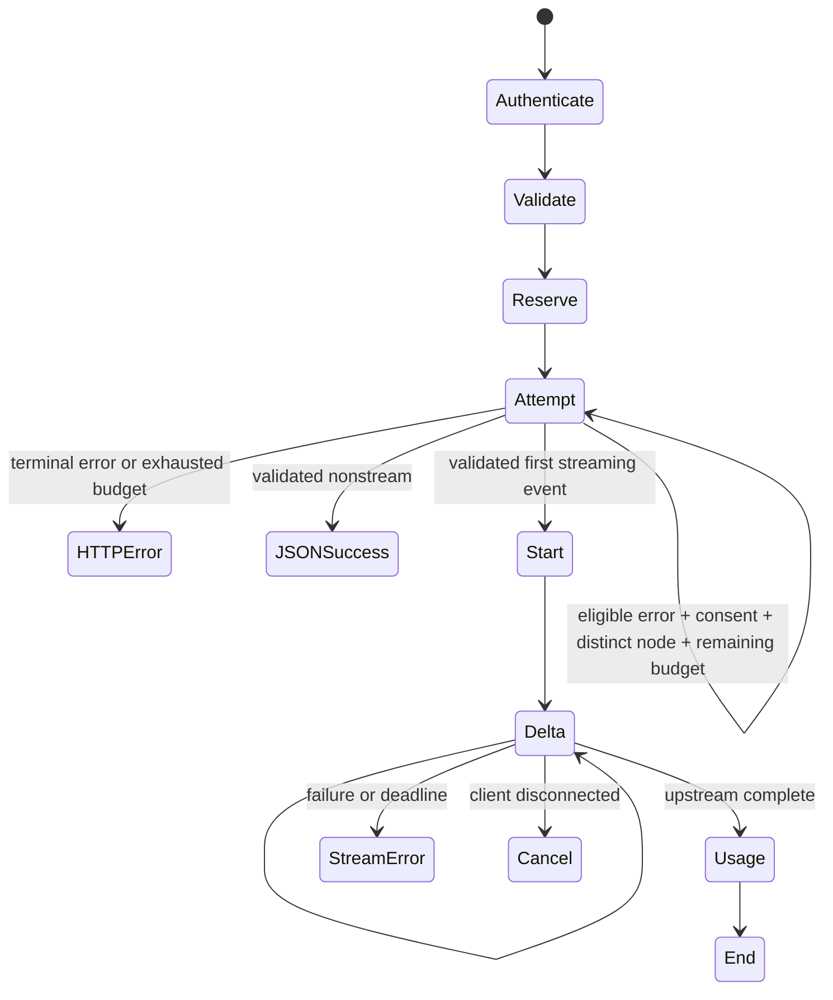

# Gateway v1 contract

This contract intentionally tightens the prototype. `/ask` is an authenticated
alias of `/v1/inference`; old request bodies remain valid except `research_mode`,
which is replaced by explicit `web_enrichment`. Unknown fields are rejected.

`GET /`, `/health`: public minimal liveness, no node/config/counters.
`GET /ready`: public boolean configuration/circuit readiness; no generation probe.
`GET /openapi.json`: public interface schema only. Interactive docs disabled.

Documented error descriptions are explicit and stable across Python 3.12/3.13,
including 413 "Request Entity Too Large" and 422 "Unprocessable Entity". These
contract labels do not alter numeric HTTP statuses, validation or ErrorEnvelope.
`POST /v1/inference`, `/ask`: inference Bearer token only.
`GET /v1/models`: inference token, registered public provider IDs/models only.
All `/v1/status`, `/v1/providers`, `/v1/monitoring/*` and strategy/reset routes:
admin Bearer token only. Missing admin hash means 503/disabled, never grant access.
No log deletion or arbitrary endpoint-management API. Provider edits require a
private config edit and restart. `/v1/providers/reset` requires `{"confirm":true}`,
rejects active requests and never resets quota reservations.

Inference JSON: prompt (1..32000 characters), optional system_prompt (<=4000),
max_tokens (1..4096, default 512), temperature (0..2), stream (default false),
optional provider (registered ID), allow_fallback (default false),
allow_policy_fallback (default false), max_attempts
(1..3, default 1), web_enrichment (default false). Global input body cap: 64 KiB.
Global deadline, attempt count, concurrent requests and conservative output token
reservations apply across all attempts; max_tokens is reserved for each attempt.
Actual input/output usage is nullable when a provider does not report it.

Nonstream 200: response, provider ID, provider type, model, request_id, attempts,
usage (input_tokens/output_tokens/source), sources. No success placeholders.
Errors: `{"error":{"code":"...","message":"fixed safe text", "request_id":"..."}}`.
401 missing/invalid API token; 403 wrong role; 413 body limit; 422 invalid request;
429 gateway concurrency/reservation limit; 503 no provider/circuit/budget;
502 upstream auth/billing/policy/schema/request; 504 total deadline.
Upstream status is safe metadata, never forward raw body/reason/header.

SSE is UTF-8 `event: NAME\ndata: JSON\n\n`. Prefetch and validate the first provider
event before returning HTTP 200. `start` identifies provider/model/attempts, then
`delta` contains response text, `usage` contains measured nullable usage and
`end` confirms completion. Once `start` is emitted, no provider switch is allowed.
Post-start failure emits `error` and closes without `end`. Client disconnect cancels
and closes upstream. A missing upstream terminator is a schema failure. There is
no `[DONE]` downstream; clients must require `end`, and never treat `error` as success.

Fallback is limited to explicitly consented registered nodes, only before output
and only for 5xx/network/timeouts within the shared deadline. Same-policy/billing
is required unless the operator lists the target in the source node fallback_to
and the request also sets allow_policy_fallback:true. This permits deliberately
authorized Cloudflare-to-Ollama fallback without changing privacy/cost by default. 429
opens cooldown and stops this request (no account rotation). 401/403, billing,
schema/model/request/policy/refusal never fallback. No default remote or paid node.

