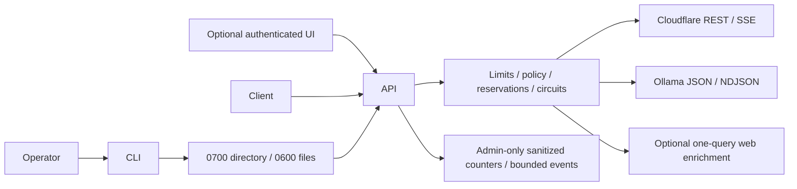

# AI Gateway Multi-Node architecture and adapter development

CLI owns explicit bootstrap/metadata; API owns authorization, request limits and
response framing. Router owns session reservations, circuit state and explicit
policy-bound attempts. HTTP adapters normalize provider formats into typed Chunk
(response/done/nullable measured Usage). Optional web enrichment and UI have no
special access around the API. Storage is private operator configuration plus
bounded ephemeral counters; no request content database, vector store or agent OS.

See the state machine and auth matrix in [API contract](api/contract.md).
Provider IDs/models always come from validated operator registration. Cloudflare
REST result.response and streaming response/usage fields are accepted; Ollama
requires matching model, boolean done, string response and numeric usage fields.
Malformed, missing terminator, refusal or error envelopes are failures, not content.
HTTP errors are mapped before attempting normalization. No OpenAI-compatible claim.

To add an adapter, first define supported text/stream/usage/error capabilities and
operator endpoint policy. Implement the Adapter.generate AsyncGenerator contract
without exposing raw provider bodies, credentials, arbitrary caller headers or
automatic retries. The router decides all retries. Every iterator must close its
HTTP response on cancellation and errors. Treat EOF without a terminator as failure.
Never yield a success sentinel or fallback inside the adapter.

Add local real-HTTP fixtures for success, schema errors, all status classes,
fragmented framing, disconnect and post-output failure. Prove budgets using exact
server request counts and verify no fallback on terminal errors. Do not ship fixture
providers in runtime. Extending compatibility requires actual contract evidence and
a separately authorized live smoke; metadata validation alone is insufficient.
